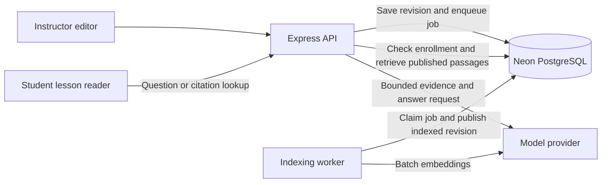

# ClasslyAI architecture

ClasslyAI is a course workspace with a tutor that shows its sources. The first release is a seeded demo on isolated infrastructure. An instructor publishes a Markdown lesson, the system indexes it, and an enrolled student asks a question. The answer links back to exact passages, and a reproducible benchmark shows how well retrieval works.

## Stack and boundaries

| Component | Responsibility |
| --- | --- |
| React and Vite | Instructor lesson editor, student reader, tutor, and citation navigation. |
| Express API | Sessions, course policy, lesson publishing, tutor requests, and citation resolution. Serve the client and API on one origin for the demo. |
| Indexing worker | Claim durable jobs, split Markdown into passages, batch embedding requests, and activate indexed revisions. Run it as a separate process from the same repo. |
| Neon PostgreSQL | Course membership, immutable revisions, search passages, jobs, sessions, and minimal operational metadata. Use full-text search and `pgvector` in the same database. |
| One model provider | Embeddings and structured answer generation behind a small interface. Use a deterministic test adapter for local checks and a live provider for the recorded demo. |

Use Node.js 24, versioned SQL migrations, and `pg` from Express and the worker. Keep migrations on a direct Neon connection and give the API and worker runtime roles the privileges they need. Use Markdown for the first demo. Enable private object storage in a later phase when the app handles file uploads.

## Data and state transitions

- **Access.** `users`, `sessions`, `courses`, and `course_memberships` hold identity and course roles. Enforce a unique membership per user and course. Keep enrollment independent of viewing progress. For the seeded demo, use two student accounts with different enrollments and an instructor account. Use server-side sessions with an opaque cookie, expiry, revocation, secure production settings, and an origin check for writes.
- **Publishing.** `lessons` holds the active published revision. `lesson_revisions` keeps immutable content versions and records publication and withdrawal timestamps. Saving a draft has no indexing side effect. Publishing creates or reuses an indexing job and keeps the last published revision live while work runs. Activate the requested revision and finalize the job in one transaction, conditional on that revision still being the newest publish request. A slow older job cannot replace a newer revision.
- **Indexing.** `ingestion_jobs` tracks status, attempts, next attempt, and lease expiry. Claim one job in a short transaction using `FOR UPDATE SKIP LOCKED`. Release the transaction before calling the provider. Use a lease token to guard writes, reclaim expired leases, and limit retries. Give each job a unique revision and pipeline fingerprint. Persist passages idempotently by revision and ordinal. A retried provider call can still incur usage.
- **Passages.** `lesson_chunks` stores the revision, section heading, offsets into the source, searchable text, and embedding. Include the chunker and embedding model versions in the pipeline fingerprint. Use a GIN index for full-text search and exact vector search on the demo corpus. Consider an approximate vector index only after measuring it on a representative corpus.
- **Evidence.** Record a request ID, retrieval configuration, published revision and passage IDs, rank, and stage timings for a sample trace. Keep student questions and answer text out of operational logs. New questions search the active revision. Existing citations can open older published revisions while those revisions are available and the viewer still has course access. Show a source-unavailable state after withdrawal or access revocation.

## Tutoring request

1. Validate the session, course scope, input length, and per-user request budget.
2. Fetch a bounded top-k list from keyword and vector search with the same course and published-revision filters. Merge the rankings using reciprocal rank fusion. Skip the provider call when the search returns no eligible evidence.
3. Treat passages as untrusted content. Ask the model for structured claims with passage IDs and supporting excerpts, or an explicit insufficient-evidence result. Set deadlines and output limits.
4. Validate the response schema, confirm each passage is from the retrieved set, and confirm each excerpt matches the stored source. Reject invalid output or return a safe fallback on provider failure. Use labeled evaluation to measure whether the cited excerpts support the claims.
5. Return answer text, citation links, and a request ID. Render lesson content and generated text safely. The reader highlights the cited span on desktop and opens a focus-managed source sheet on mobile.

## Evidence of quality

Use a checked-in synthetic corpus with near-duplicate passages across courses and a labeled question set. Compare keyword, vector, and hybrid with the same passage corpus, permissions, and top-k. Include exact terms, paraphrases, unsupported questions, and questions whose strongest match lives in another course. Record the corpus and pipeline versions with each report.

| Measure | How to show it |
| --- | --- |
| Retrieval quality | Report Recall@5 for queries with eligible gold passages and show representative misses for each strategy. |
| Answer faithfulness | Check expected abstentions and inspect whether visible claims are supported by their cited spans. Report the number of examples assessed. |
| Isolation and reliability | Test cross-course retrieval and citation denial, draft exclusion, revocation, retries, lease recovery, and stale revision activation. |
| Performance | Report p50 and p95 for retrieval and the full answer path separately, along with sample count, environment, and provider mode. Report token usage where the provider returns it. |

The demo should show a paraphrased question, its highlighted evidence, a real comparison report, a newly indexed correction, and an unsupported question. Label fixture runs and live provider runs separately so reviewers can reproduce the right result.

[Neon PostgreSQL vector extension](https://neon.com/docs/extensions/pgvector) · [pgvector hybrid search](https://github.com/pgvector/pgvector#hybrid-search) · [PostgreSQL queue row locking](https://www.postgresql.org/docs/current/sql-select.html) · [OWASP RAG security](https://cheatsheetseries.owasp.org/cheatsheets/RAG_Security_Cheat_Sheet.html)
